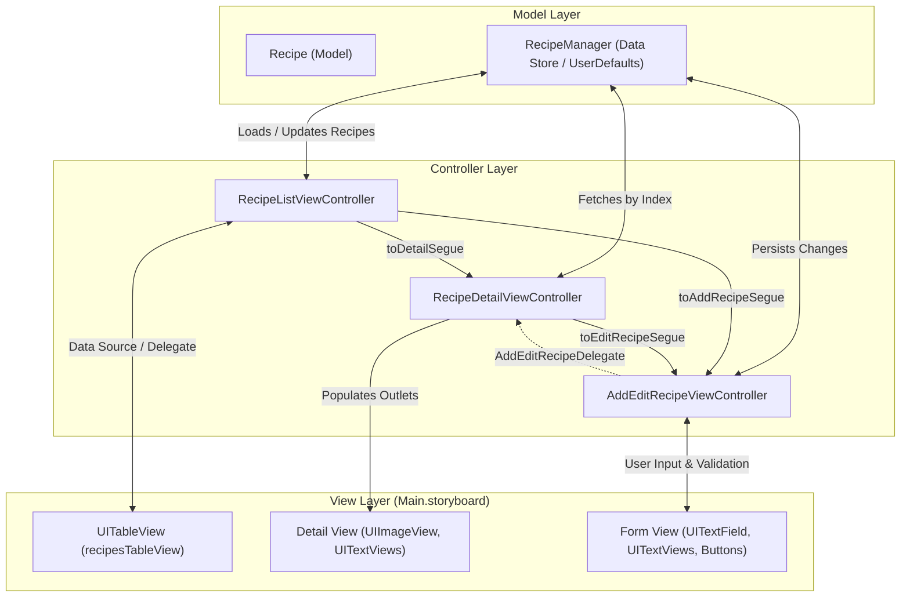
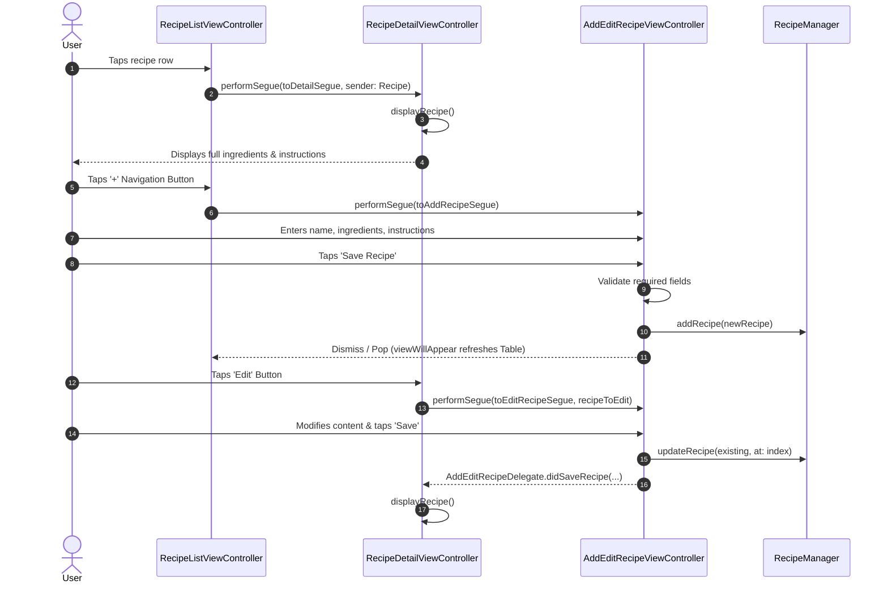

# System Design Document: Recipe Organizer (Project 87)

**Project:** Project 87: Recipe Organizer  
**Difficulty:** Intermediate  
**Target Platform:** iOS 17.0+  
**Architecture:** Model-View-Controller (MVC)  
**UI Framework:** UIKit with Interface Builder (`Main.storyboard`)  
**Language:** Swift 5.0+  

---

## 1. System Overview & Objectives

### 1.1 Objective
The **Recipe Organizer** is an iOS application designed to allow users to store, browse, search, edit, and delete culinary recipes across multiple dedicated screens. The application emphasizes fundamental iOS developer competencies:
- Multi-screen navigation with `UINavigationController` and Storyboard segues.
- Data presentation and row lifecycle management via `UITableView`.
- Multi-line text input and display using `UITextView`.
- Form validation and structured data modeling.
- Complete CRUD (Create, Read, Update, Delete) capability with local data persistence.
- Media integration using `UIImagePickerController` for recipe photos.

---

## 2. Architecture & Design Pattern

The application strictly adheres to Apple's **Model-View-Controller (MVC)** architectural paradigm:



### 2.1 Component Responsibilities
- **Model (`Recipe`, `RecipeManager`)**:
  - Defines recipe data structures (`Recipe`) conforming to `Codable` and `Equatable`.
  - Manages CRUD state, disk serialization/deserialization with `UserDefaults`, and default starter datasets.
- **View (`Main.storyboard`, `LaunchScreen.storyboard`)**:
  - Declarative visual hierarchy, AutoLayout constraints, and Interface Builder outlet bindings.
- **Controllers (`RecipeListViewController`, `RecipeDetailViewController`, `AddEditRecipeViewController`)**:
  - Orchestrate data binding between views and models.
  - Implement delegate protocols (`UITableViewDataSource`, `UITableViewDelegate`, `UISearchBarDelegate`, `UIImagePickerControllerDelegate`, `AddEditRecipeDelegate`).
  - Manage navigation lifecycle, parameter passing, and alert dialogs.

---

## 3. Navigation & Screen Flow

The application utilizes a hierarchical navigation architecture managed by a root `UINavigationController`.



---

## 4. Detailed Screen & Interface Builder Specifications

### 4.1 Screen 1: Recipe List Screen (`RecipeListViewController`)
- **Base Controller:** `UIViewController`
- **Protocols:** `UITableViewDataSource`, `UITableViewDelegate`, `UISearchBarDelegate`
- **Storyboard Scene ID:** `LIST-VC`
- **Components & Connections:**
  - `recipesTableView` (`UITableView`): Bound to `RecipeListViewController`. Uses prototype cell `RecipeCell` (style `Subtitle`).
  - `searchBar` (`UISearchBar`): Pinned directly below safe area top constraint; real-time query dispatching to `func searchRecipes()`.
  - `navigationItem.rightBarButtonItem`: System `.add` icon triggering `addRecipe()`.
- **Key Functions:**
  - `func addRecipe()`: Triggers `"toAddRecipeSegue"`.
  - `func deleteRecipe(at index: Int)`: Removes the recipe from both local filter buffer and `RecipeManager`, animating row deletion.
  - `func searchRecipes()`: Evaluates search text against recipe names and ingredient lines with case-insensitive filtering.
  - `func tableView(_:commit:forRowAt:)`: Swipe-to-delete action presenting a confirmation alert before deletion.

### 4.2 Screen 2: Recipe Detail Screen (`RecipeDetailViewController`)
- **Base Controller:** `UIViewController`
- **Protocols:** `AddEditRecipeDelegate`
- **Storyboard Scene ID:** `DETAIL-VC`
- **Components & Connections:**
  - `recipeImageView` (`UIImageView`): 180pt height, aspect-fill ratio with corner radius 12, displaying user photo or system symbol.
  - `recipeNameLabel` (`UILabel`): Bold 24pt dynamic font supporting multiline wrapping.
  - `ingredientsTextView` (`UITextView`): Non-editable, styled border, displaying newline-separated ingredients list.
  - `instructionsTextView` (`UITextView`): Non-editable, styled border, displaying numbered preparation steps.
  - `navigationItem.rightBarButtonItems`:
    - "Edit" (`UIBarButtonItem`): Segues to `AddEditRecipeViewController` with the active recipe instance.
    - System Trash (`UIBarButtonItem`): Prompts confirmation to delete the current recipe and pops back to the list.
- **Key Functions:**
  - `func displayRecipe()`: Binds the active `Recipe` model properties to UI outlets.

### 4.3 Screen 3: Add / Edit Recipe Screen (`AddEditRecipeViewController`)
- **Base Controller:** `UIViewController`
- **Protocols:** `UIImagePickerControllerDelegate`, `UINavigationControllerDelegate`, `UITextFieldDelegate`
- **Storyboard Scene ID:** `ADD-VC`
- **Components & Connections:**
  - `recipeNameTextField` (`UITextField`): Rounded rect style, single-line recipe title input.
  - `ingredientsTextView` (`UITextView`): Multi-line input for ingredients.
  - `instructionsTextView` (`UITextView`): Multi-line input for step-by-step instructions.
  - `recipeImageView` (`UIImageView`): 140x140 square preview with tap gesture recognizer for image selection.
  - `selectImageButton` (`UIButton`): Action sheet launcher (`"Take Photo"` / `"Choose from Library"` / `"Remove Photo"`).
  - `saveButton` (`UIButton`): Prominent 50pt rounded primary button executing validation and persistence.
- **Validation Rules:**
  1. `recipeNameTextField.text` must not be whitespace-only or empty.
  2. `ingredientsTextView.text` must not be whitespace-only or empty.
  3. `instructionsTextView.text` must not be whitespace-only or empty.
  - Any failure presents a non-blocking modal `UIAlertController` focusing the missing field.

---

## 5. Interface Builder Component Mapping

| Required IB Component | Class Type | Variable Name | Controller | Location in Interface |
|---|---|---|---|---|
| `UITableView` | `UITableView` | `recipesTableView` | `RecipeListViewController` | Main screen center |
| `UITextField` | `UITextField` | `recipeNameTextField` | `AddEditRecipeViewController` | Top form entry field |
| `UITextView` | `UITextView` | `ingredientsTextView` | `RecipeDetailViewController` | Ingredients section box |
| `UITextView` | `UITextView` | `ingredientsTextView` | `AddEditRecipeViewController` | Ingredients input box |
| `UITextView` | `UITextView` | `instructionsTextView` | `RecipeDetailViewController` | Instructions section box |
| `UITextView` | `UITextView` | `instructionsTextView` | `AddEditRecipeViewController` | Instructions input box |
| `UIImageView` | `UIImageView` | `recipeImageView` | `RecipeDetailViewController` | Top banner view |
| `UIImageView` | `UIImageView` | `recipeImageView` | `AddEditRecipeViewController` | Center photo avatar |
| `UIButton` | `UIButton` | `saveButton` | `AddEditRecipeViewController` | Bottom form action button |
| `UIButton` | `UIButton` | `selectImageButton` | `AddEditRecipeViewController` | Under image avatar |

---

## 6. Data Model & Persistence Strategy

### 6.1 Entity Definition (`Recipe.swift`)
```swift
struct Recipe: Codable, Equatable {
    var id: UUID = UUID()
    var name: String
    var ingredients: String
    var instructions: String
    var imageData: Data?
    
    var image: UIImage? {
        guard let data = imageData else { return nil }
        return UIImage(data: data)
    }
}
```

### 6.2 Storage Architecture (`RecipeManager`)
- **Pattern:** Thread-safe Singleton (`RecipeManager.shared`).
- **Storage Target:** `UserDefaults.standard` under key `"SavedRecipesList"`.
- **Serialization:** `PropertyListEncoder` / `JSONEncoder` converting `[Recipe]` to binary representation.
- **Image Handling:** Selected `UIImage` instances are compressed via `image.jpegData(compressionQuality: 0.7)` and stored inline as binary `Data?`.
- **First-Run Seed Data:** If no prior record exists in storage, three starter recipes (*Classic Fluffy Pancakes*, *Fresh Guacamole*, *Tomato Basil Penne*) are automatically initialized.

---

## 7. Privacy & Permissions

To support photo capture and library import per Apple's App Store Review Guidelines, `Info.plist` defines:

| Key | Value Description |
|---|---|
| `NSPhotoLibraryUsageDescription` | "Recipe Organizer needs photo library access so you can select photos for your recipes." |
| `NSCameraUsageDescription` | "Recipe Organizer needs camera access so you can take photos of your dishes." |

---

## 8. UX Considerations & Safeguards

1. **Scroll Containment**:
   - Both Detail and Add/Edit screens wrap content in a parent `UIScrollView` pinned to safe area guides, ensuring accessibility across all device dimensions (e.g., iPhone SE up to iPad Pro).
2. **Keyboard Management**:
   - Tap-to-dismiss background gesture recognizer (`dismissKeyboard`) attached to the root view.
   - Return key on `recipeNameTextField` automatically shifts first responder focus to `ingredientsTextView`.
3. **Empty States**:
   - `recipesTableView.backgroundView` displays a helpful empty state label when no recipes exist or when search yields zero results.
4. **Destructive Action Safety**:
   - Both table swipe deletion and detail screen trash buttons require explicit user confirmation via destructive action sheets/alerts.
